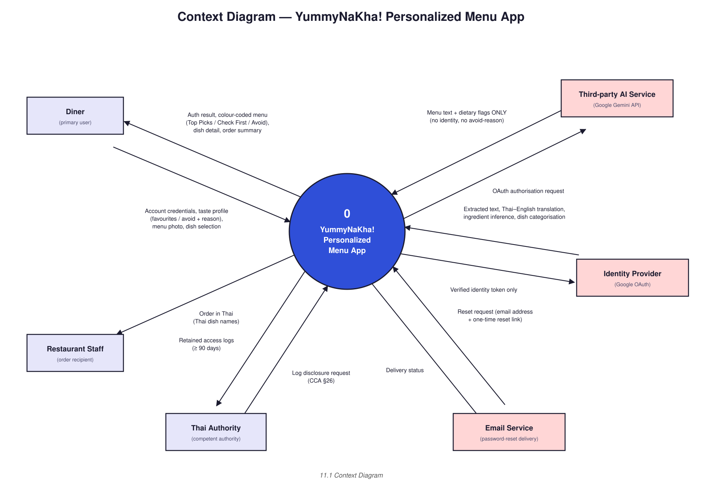

# Diagram 1 of 4 — Context

Shows YummyNaKha! as one box against everything outside it: the **Diner**
(primary actor), the **identity provider** used for OAuth
sign-in and token exchange (LR6), and the **Thai authority** that may request
traffic-log data retained for ≥ 90 days under CCA §26 (LR7).

*Revised 2026-10-27:* the **third-party AI service** (Google Gemini API) is
no longer outside the boundary — menus are read by our own OCR service inside
YummyNaKha! and matched to our Thai dish guide, so no menu or profile data
crosses the boundary to an AI provider (LR2, LR3). The SVG below still draws
the Gemini actor and must be redrawn without it.

