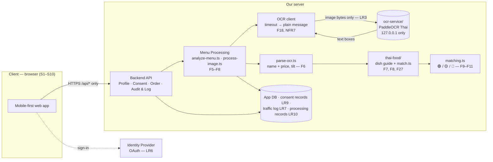
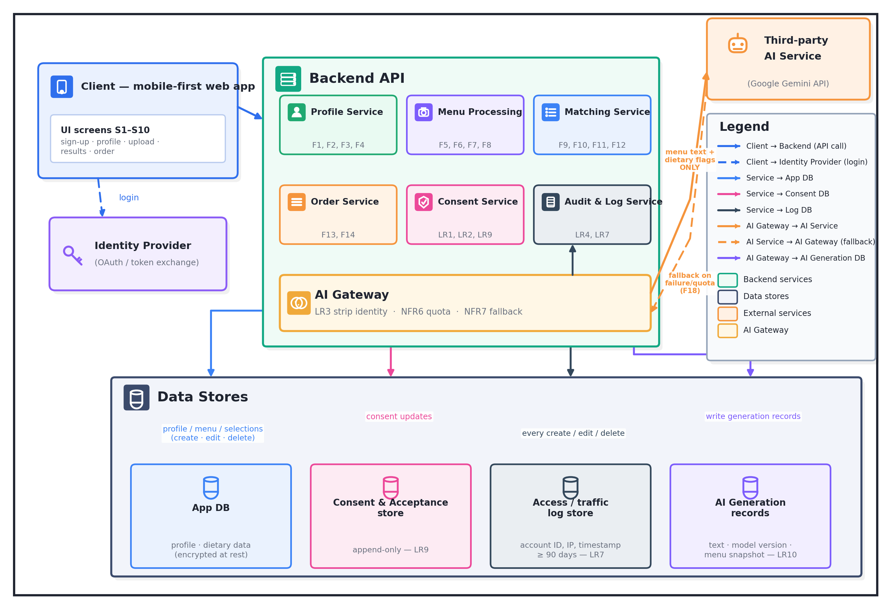

# Diagram 3 of 4 — Architecture

*Revised 2026-10-27* — the Google Gemini API / Hugging Face pipeline is
replaced by the team's own OCR service and Thai dish guide (spec *Team
decisions 2026-10-27*). The PNG below still shows the old **AI Gateway →
Gemini** path and must be redrawn; until then the Mermaid diagram on this page
is the current architecture.

Shows the client, the backend services behind it, and the data stores they
write to:

- **Client** — the mobile-first web app, screens S1–S10 (Next.js,
  `YummyNaKha_App/app`, `components/`).
- **Identity Provider** — OAuth sign-in and token exchange (LR6).
- **Backend API** (Next.js route handlers, `lib/server/`) — Profile Service
  (F1–F4), Menu Processing Service (F5–F8, F27: `lib/server/ai/analyze-menu.ts`,
  `process-image.ts`), Matching Service (F9–F12: `lib/matching.ts`), Order
  Service (F13, F14), Consent Service (LR1, LR2, LR9) and Audit & Log Service
  (LR4, LR7). The OCR client (`lib/server/ocr/client.ts`) turns an OCR outage or
  timeout into a plain-language message (F18, NFR7).
- **OCR service** — `YummyNaKha_App/ocr-service/` (Python, FastAPI, PaddleOCR
  Thai model), run next to the app on our server and bound to `127.0.0.1`.
  Receives **image bytes only** and returns text boxes with positions (LR3).
  No third party, no API key.
- **Menu parser** — `lib/server/menu/parse-ocr.ts` pairs each name with the
  price on its row, correcting for tilt (F6).
- **Thai dish guide** — `lib/server/thai-food/` (`dishes.ts`, `variants.ts`,
  `ingredients.ts`, `match.ts`): reviewed dish data and the matcher that gives
  each menu line its English name and ingredients (F7, F8, F27, F28). Draft until
  the Thai-literate review.
- **Data stores** — App DB (profile and dietary data), the append-only consent
  and acceptance store (LR9), the access/traffic log store kept ≥ 90 days (LR7),
  and the processing records — OCR model, guide version, OCR text, profile
  snapshot, result (LR10).

**The explicit trade-off:** menus are read by **our own OCR service and a
team-curated Thai dish guide, not a general-purpose AI model**. We give up
coverage: a dish that is not in the guide gets no English name and no
ingredients and is always 🟡 check before ordering, and menus of non-Thai
restaurants are out of scope. In return a scan is fast (one engineering
measurement: ~6 s for a 16-dish menu on an M3 Pro laptop, against 1–2 minutes
before — NFR5), the same dish always gets the same reviewed ingredients
(F8, F27), there is no per-call cost or quota (NFR6), and no menu or profile
data leaves our server, which removes the third-party transfer (LR2, LR3).
The cost moves to people: the guide must be reviewed by a Thai-literate team
member and grown as real menus show gaps (NFR10).

A second trade-off is kept from the first design: every OCR call is made **from
the API layer, never from the browser**. That costs a network hop and makes the
app useless offline, and it keeps the OCR service off the public network and
server-only configuration out of the client bundle (LR3, LR6d).

A third, smaller trade-off: **the uploaded image lives in storage for the scan
session only** — its bytes are cleared once the OCR text is read — so a diner
cannot reopen an old scan. That is deliberate — no permanent image store, no
scan history (LR5, F20 Won't).

