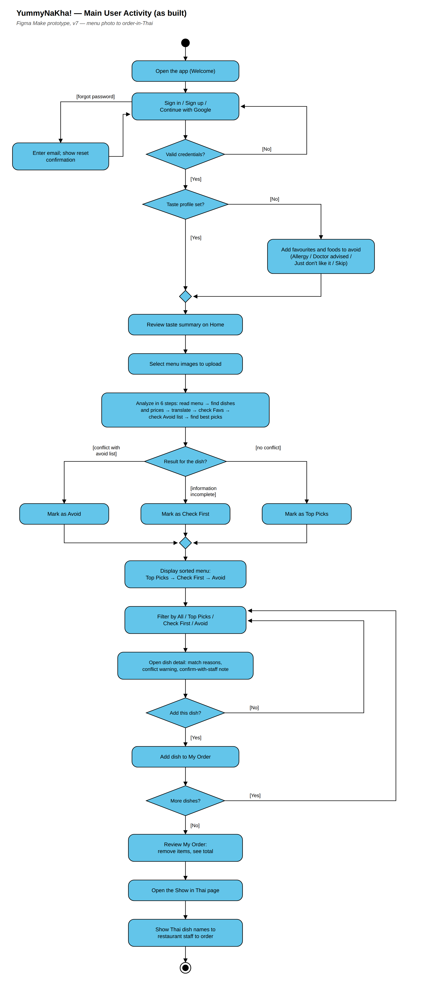

# Diagram 4 of 4 — Activity

Shows the core workflow as a single flow with its decision points: sign-in and
food profile, the **consent gate** — Terms, privacy notice, and AI & Accuracy
Disclaimer accepted _before_ any menu is processed (LR1, LR2, F15), the
readable-image check, the call to our own OCR service with the image bytes only
(LR3), the **OCR-availability branch** (service down or timed out) that ends in
a plain-language message rather than a failure (NFR7, F18), the Thai dish guide
match where a dish not in the guide goes to Check First (F10, F27), the branch that
sorts every dish into Recommended, Check First or Avoid — anything uncertain or
incomplete resolves to Check First, never to Recommended (F10, LR12) — and the
selection and Thai order screen, which never re-runs the analysis and never
shows English (F13, F14).

*Revised 2026-10-27:* no data reaches a third-party OCR/AI provider any more,
so the gate no longer includes a separate transfer consent (LR2). The PNG below
still shows the transfer consent and the Gemini quota branch and must be
redrawn.

