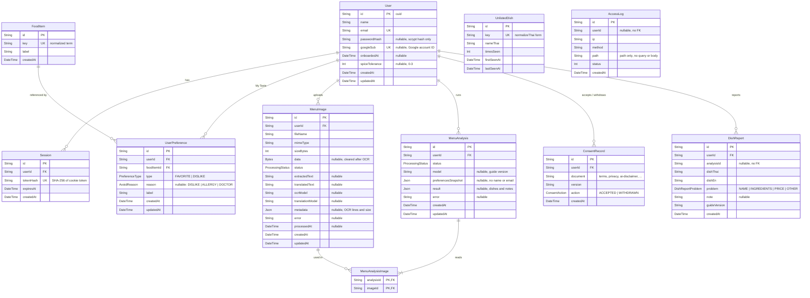

# Diagram 5 — Entity-Relationship (database)

*Added 2026-11-17.* Generated by hand from
[`YummyNaKha_App/prisma/schema.prisma`](../../../YummyNaKha_App/prisma/schema.prisma)
(PostgreSQL, Prisma 7, migrations up to `20261031090000_guide_feedback_spice`).
If the schema changes, update this page in the same change.

## Notes

| Point | Where in the schema | Requirement |
| --- | --- | --- |
| Every user-owned table uses `onDelete: Cascade`, so deleting a `User` removes sessions, My Taste, menu photos, analyses, consents and reports | all `@relation` lines on `User` | LR5 (PDPA full delete) |
| `UserPreference.reason` = `ALLERGY` / `DOCTOR` is sensitive health data | `enum AvoidReason` | LR1 |
| `@@unique([userId, foodItemId])` makes Favourite and Avoid mutually exclusive for one food | `UserPreference` | F2, F3 |
| Menu photo bytes are deleted once OCR succeeds | `MenuImage.data` (set to `null` in `process-image.ts`) | LR5 |
| `MenuAnalysis.preferencesSnapshot` + `result` + `model` are the internal AI-processing quality record | `MenuAnalysis` | LR10 |
| `ConsentRecord` is append-only (accept **and** withdraw rows, with version) | `ConsentRecord` | LR2, LR9 |
| `AccessLog` has **no** foreign key and no content, so it outlives a deleted account and is kept ≥ 90 days apart from user content | `AccessLog` | LR7, LR8 (Computer Crime Act §26) |
| `UnlistedDish` is anonymous: dish text only, not linked to a user, scan or image | `UnlistedDish` | guide improvement |
| `DishReport.analysisId` is a plain string, not a foreign key | `DishReport` | — |
