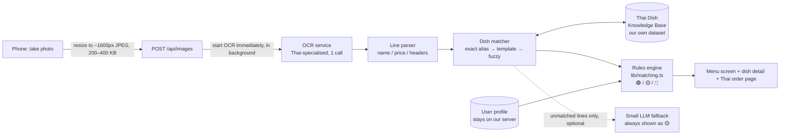

# Architecture v2 proposal — fast, Thai-food-only menu scan

**Status:** PROPOSAL — needs team decision (see §8) before the spec, backlog and
diagrams are updated. Written 2026-10-27, the day before Beta Review (W11).

**Why:** (1) a scan takes **60–120 s** against our own target of **≤ 10 s
(NFR5)**; (2) the teacher does not want us to depend on the free Gemini API;
(3) the teacher suggests narrowing scope to **Thai restaurants only** and
showing **much more detailed ingredients** per dish.

---

## 1. Why the current pipeline is slow (diagnosis from the code)

Current flow (`lib/server/ai/analyze-menu.ts` → `process-image.ts`):

```
phone photo (full size, up to 8 MB, never resized)
  └─▶ [1] OCR      — Qwen 27B vision model on Hugging Face, writes out the whole menu   ~20–60 s
        └─▶ [2] Translate — same 27B model again, rewrites the whole menu in English    ~15–40 s
              └─▶ [3] Gemini — writes JSON with ingredients for EVERY dish                ~20–60 s
                    (free tier: 503/429 → retry 1 s → fallback model → fallback model)
```

| Cause | Where | Effect |
| --- | --- | --- |
| **Three large-model calls in series**, each generating the full menu as text | `process-image.ts`, `analyze-menu.ts` | Time is dominated by output tokens; three passes ≈ 3× the wait |
| **Step 2 is redundant** — Gemini already produces `nameEn` in step 3 | `translateMenu()` | One full LLM pass for nothing |
| **Ingredients are re-invented by AI on every scan**, for every dish | `build-gemini-prompt.ts` | Biggest output (thousands of tokens); also non-deterministic, so the same dish gets different ingredients on different days |
| **Free-tier Gemini is overloaded / rate-limited** | `gemini/client.ts` retry + fallback chain | Unpredictable extra 10–60 s, sometimes a failure |
| **Photos are uploaded at full resolution** (no client resize) | `components/home/menu-uploader.tsx`, `lib/api/menu.ts` | Slower upload; more vision tokens; slower OCR |
| **Multiple photos processed one after another** | `for (const id of imageIds) await …` | 2 photos ≈ 2× time |
| **OCR only starts when the user presses "Find My Food"** | `/api/ai/analyze` | Upload-to-press time is wasted |

**Root cause:** we ask a general-purpose LLM to *re-derive Thai cuisine from
scratch on every request*. But Thai restaurant menus repeat a small, known set
of dishes. That knowledge should be **stored once, reviewed by us, and looked
up** — not generated each time.

---

## 2. Proposed architecture: OCR → match against our own Thai Dish Knowledge Base



| Step | What happens | Expected time |
| --- | --- | --- |
| Client resize | Canvas resize to max 1600 px long edge, JPEG q≈0.8 | < 0.5 s |
| Upload | 200–400 KB instead of 3–8 MB | ~1 s |
| OCR (one call) | Thai-specialised OCR returns lines (see §4). Starts **as soon as the upload finishes**, while the user is still on the Home screen | 2–8 s |
| Parse + match | Pure code + one DB query (Postgres `pg_trgm`) | < 0.2 s |
| Rules | Existing deterministic `categorizeMenu()` | < 0.05 s |
| **Total after pressing "Find My Food"** | Often already done; worst case | **≈ 3–10 s** (meets NFR5) |

What disappears: the translation call, the Gemini call, the retry/fallback
chain, and sending the user's preferences to any third party.

---

## 3. The Thai Dish Knowledge Base (KB) — "our own data"

This is the realistic meaning of *"train data ourselves"* for a 3-week window:
the team builds and reviews its **own dataset of Thai dishes**. It is also what
gives the teacher's **"more detailed ingredients"** — every dish is described
by people, consistently, instead of by a model guessing on the fly.

### 3.1 Data model (new Prisma tables)

```prisma
model ThaiDish {
  id           String   @id @default(cuid())
  slug         String   @unique            // "pad-kra-pao"
  nameTh       String                      // "ผัดกะเพรา"
  nameEn       String                      // "Stir-fried holy basil"
  aliases      String[]                    // ["ผัดกระเพรา", "กะเพรา", "ผัดกระเพา"] — real spellings seen on menus
  category     String                      // stir-fry | curry | soup | salad | noodle | rice | dessert | drink …
  region       String?                     // central | isan | north | south
  description  String                      // 1–2 sentences for foreigners
  spiceLevel   Int                         // 0–3 typical
  takesProtein Boolean  @default(false)    // template dish: ผัดกะเพรา + หมู/ไก่/กุ้ง…
  reviewedBy   String?                     // team member who checked it
  sources      String[]                    // where the recipe info came from
  ingredients  DishIngredient[]
}

model Ingredient {
  id          String   @id @default(cuid())
  key         String   @unique              // "fish-sauce"
  nameEn      String                        // "fish sauce"
  nameTh      String                        // "น้ำปลา"
  allergens   String[]                      // ["fish"] ; oyster sauce → ["shellfish","gluten"]
  diet        String[]                      // ["pork"], ["alcohol"], ["animal"] …
  dishes      DishIngredient[]
}

model DishIngredient {
  dishId       String
  ingredientId String
  role         String   // protein | vegetable | herb | sauce | seasoning | garnish | side
  presence     String   // always | usually | sometimes   → maps to listed / common
  note         String?  // "often served with a fried egg (ไข่ดาว)"
  @@id([dishId, ingredientId])
}

model Protein {          // for template dishes
  token        String @id   // "หมูสับ", "ไก่", "กุ้ง", "ทะเล", "หมูกรอบ"
  ingredientId String       // links to Ingredient (allergens come along)
  nameEn       String       // "minced pork"
}
```

`presence` maps directly to today's `InferredIngredient.certainty`
(`always` → `listed`; `usually` / `sometimes` → `common`), so
`lib/matching.ts`, `dish-card.tsx` and the 🟢 / 🟡 / 🔴 rules keep working.

### 3.2 What the dish detail screen can now show (teacher's request)

- English name, Thai name, short description, region, typical spice level
- Ingredients **grouped by role**: protein · vegetables & herbs · sauces &
  seasonings · garnish · served with
- **Hidden ingredients** called out: fish sauce, shrimp paste (กะปิ), oyster
  sauce, palm sugar, MSG, peanuts, dried shrimp, pork lard
- **Allergen groups** derived from ingredients (fish, shellfish, peanut,
  gluten, soy, egg, dairy, sesame) — so an Avoid item "shellfish" now catches
  shrimp, crab, oyster sauce and shrimp paste, which the current exact-word
  match misses
- **"Ask the staff" phrases in Thai** on the order page, e.g. ไม่ใส่ถั่ว (no
  peanuts), ไม่เผ็ด (not spicy), ไม่ใส่น้ำปลา (no fish sauce) — generated from
  the user's Avoid list, no AI needed

Safety wording does not change (rule.md): the KB describes the *usual*
recipe; the app still says only "no conflicting ingredient was detected from
the available menu information", and every 🟡 / 🔴 tells the user to confirm
with staff.

### 3.3 How big, and who builds it

- **Start with ~150 dishes** that cover most ร้านอาหารตามสั่ง / Thai restaurant
  menus, + ~15 protein tokens. Template dishes multiply coverage
  (ผัดกะเพรา × 8 proteins = 8 menu lines from 1 entry).
- 5 members × ~30 dishes each; every entry checked by a second member
  (`reviewedBy`). Kept as a CSV/JSON seed in the repo → `prisma db seed`.
- An LLM may be used **offline, once** to draft entries, but every entry is
  human-reviewed before it ships. No AI at request time for known dishes.
- Grow the alias list from real photos: every unmatched OCR line in testing
  is reviewed and either added as an alias or as a new dish.

---

## 4. Replacing Gemini — OCR options

Only one AI step remains (reading the photo). Options:

| Option | What it is | Speed | Cost | Thai quality | PDPA / third party | Effort |
| --- | --- | --- | --- | --- | --- | --- |
| **A. Typhoon OCR** (SCB 10X, Thai-built) | Open Thai-specialised OCR vision models: `typhoon-ocr1.5-2b`, `typhoon-ocr-3b`, `typhoon-ocr-7b`. Callable through an OpenAI-compatible API (OpenTyphoon) or self-hosted with vLLM | Fast with the 2B model (much smaller than today's 27B) | Hosted API: check current quota at opentyphoon.ai; self-host needs a GPU | Built for Thai documents | Hosted = still a third party (keep consent); self-host = none | **Low** — our HF client is already OpenAI-compatible; mostly change endpoint + model name |
| **B. PaddleOCR** (`th_PP-OCRv5_mobile_rec`) | Classic OCR, runs on CPU in a small Python (FastAPI) service | ~1–3 s on CPU | Free | 82.7 % line accuracy on PaddleOCR's Thai benchmark; stylised menu fonts may be worse | **No third party** — photos never leave our server | Medium — new Python service + Docker |
| C. Google Cloud Vision OCR | Paid Google OCR API | Fast | Free quota then paid | Good | Third party (Google) | Low — but it is Google again; teacher may object |
| D. Keep a general LLM (e.g. Typhoon chat model) for everything | Same design as today | Slow | — | — | — | Not recommended |

**Recommendation:** **A (Typhoon OCR 2B via API) for Beta / user testing**,
with **B (PaddleOCR) as the self-hosted alternative** if the API quota or
availability is a problem. Both plug into the same `readMenuImage()` interface
in `lib/server/ai/read-menu.ts`, so the switch stays a config flag like
`OCR_PROVIDER` today.

### Fallback for dishes not in the KB (optional, Should-have)
Unmatched lines can be sent, **text only, without the user's profile**, to a
small LLM to suggest a name and ingredients. These dishes are **always 🟡**
and labelled "not in our dish guide — ask staff". They load after the main
results (the menu screen is not blocked by them).

---

## 5. Matching algorithm (no AI)

1. **Parse lines** — strip numbering/bullets; pull the price
   (`/(\d{2,4})\s*(บาท|฿|\.-|-)?$/`); detect section headers (ต้ม, ผัด, ยำ…).
2. **Normalise Thai** — NFC, remove spaces/zero-width chars, fix common
   misspellings (กระเพรา → กะเพรา), unify ไม้ยมก, strip "ข้าว" prefix when
   the KB has a "rice + X" template.
3. **Match, in order:**
   1. exact alias lookup (hash map, built at startup);
   2. template: base-dish alias found as substring + protein token
      (ผัดกะเพรา**หมูกรอบ** → pad-kra-pao + crispy pork);
   3. fuzzy: Postgres `pg_trgm` `similarity() ≥ 0.45` to absorb OCR errors;
   4. otherwise → "unknown dish" (🟡, Thai text shown, ask staff).
4. **Build `ExtractedDish`** from the KB entry (+ protein) → existing
   `categorizeMenu()`.

Optional "we trained a model" extension (Could-have): train a tiny
character-n-gram classifier (e.g. TF-IDF + nearest neighbour) on KB aliases +
labelled OCR lines from our test photos, and report its accuracy against the
fuzzy matcher. Cheap, explainable, and a real training/evaluation story for
the presentation.

---

## 6. Other speed fixes (independent of the KB — can ship first)

1. **Resize on the phone** before upload (canvas → JPEG, max 1600 px).
2. **Start OCR right after upload** (fire `/api/ai/extract-text` from the
   uploader), so the work overlaps with the user choosing/adding photos.
3. **Delete the translation step** — `nameEn` already comes from step 3 (and
   from the KB in v2).
4. **Process multiple photos in parallel** (`Promise.all`, max 2–3).
5. **Show results progressively** — return matched dishes first; unknown-dish
   fallback fills in afterwards.

---

## 7. Impact on requirements and legal rules

| Item | Change |
| --- | --- |
| Scope | "Thai-language menus" → **Thai cuisine / Thai restaurants only**. Non-Thai dishes are out of scope (shown as unknown 🟡). |
| NFR5 latency ≤ 10 s | Becomes achievable; measure p50 / p90 on the test photo set. |
| NFR2 extraction, NFR3 translation | NFR3 becomes "KB English name correct" (human-reviewed); add **dish-match rate** (% of real menu lines matched to the right KB dish). |
| NFR4 matching fidelity | Improves: deterministic + allergen groups. |
| NFR6 cost ceiling | Only OCR costs anything; Gemini removed. |
| LR2 / LR3 (PDPA transfer, minimum data) | **Better:** allergies and doctor restrictions (sensitive health data) are **no longer sent to any third party**. Only the menu photo goes to OCR (or nothing, with PaddleOCR). Consent text must be updated to name the new provider. |
| LR10 AI-processing records | Record OCR model + KB version + matched dish IDs instead of the Gemini model. |
| Product safety rule | Unchanged wording; KB data is reviewed, "usual recipe" disclaimer stays. |
| New backlog items | KB schema + seed, matcher, OCR provider swap, client resize, dish-detail redesign, "ask staff" Thai phrases, test photo set. |

---

## 8. Decisions needed from the team

1. **OCR provider:** A Typhoon OCR API · B PaddleOCR self-hosted · A now + B later?
2. **Fallback for unknown dishes:** none (just "ask staff") · small LLM, text only, always 🟡?
3. **KB size for real-user validation (Nov 4):** 100 · 150 · 200 dishes?
4. **"Train our own" story:** KB only · KB + small dish-line classifier?
5. **What to show at Beta Review (Oct 28):** quick fixes from §6 only + this plan,
   or wait and demo v2 at real-user validation?

## 9. Suggested timeline

| When | Work |
| --- | --- |
| Oct 27–28 (Beta) | §6 quick fixes 1–3; present this proposal |
| Oct 29 – Nov 1 | KB schema + first 100 dishes; OCR provider swap; matcher |
| Nov 2–3 | 30-photo test set from real restaurants; measure match rate + latency; grow aliases |
| Nov 4 | Real-user validation on v2 |
| Nov 5–11 | KB to 150–200 dishes; detailed dish screen; Thai "ask staff" phrases; update spec, backlog, diagrams |

## Sources

- Typhoon OCR models (SCB 10X): https://huggingface.co/collections/scb10x/typhoon-ocr
- Typhoon OCR code / OpenAI-compatible usage, Apache-2.0: https://github.com/scb-10x/typhoon-ocr
- PaddleOCR PP-OCRv5 Thai recognition model: https://www.paddleocr.ai/latest/en/version3.x/algorithm/PP-OCRv5/PP-OCRv5_multi_languages.html
