# YummyNaKha! — User Guide

Read a Thai menu, see which dishes fit you, and order in Thai.

**Open the app:** https://yummy-na-kha.vercel.app

> YummyNaKha! helps you spot **possible** food conflicts from menu information.
> It cannot see how the kitchen cooks. **Always confirm serious allergies or
> medical restrictions with restaurant staff.**

*Pictures come from the design prototype
([03-prototype.md](../02-design/03-prototype.md)). The live app looks a little
different and has extra features, which are described in the text.*

---

## 1. Sign in

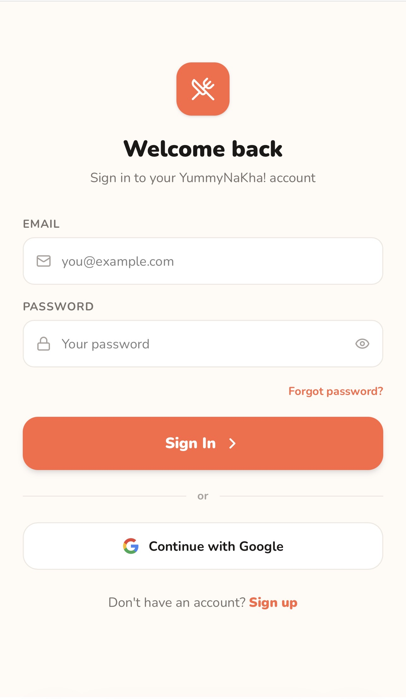

- Enter your **email** and **password**, then tap **Sign In** — or tap
  **Continue with Google**.
- New here? Tap **Sign up**.

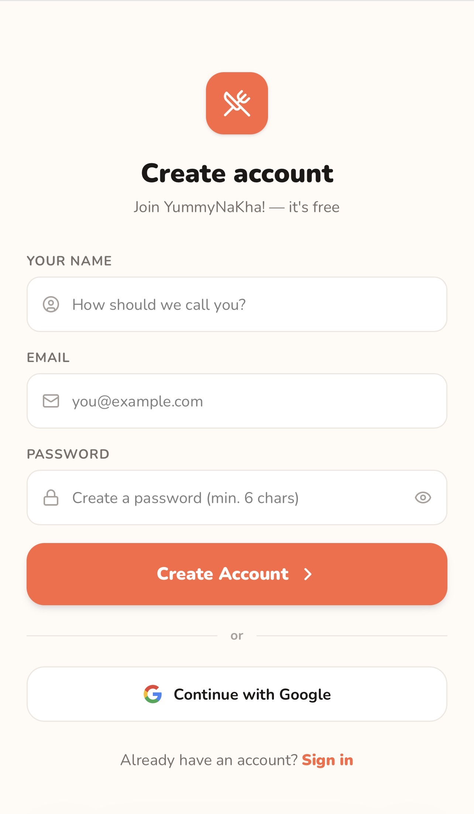

- Enter your name, email and a password, then tap **Create Account**.

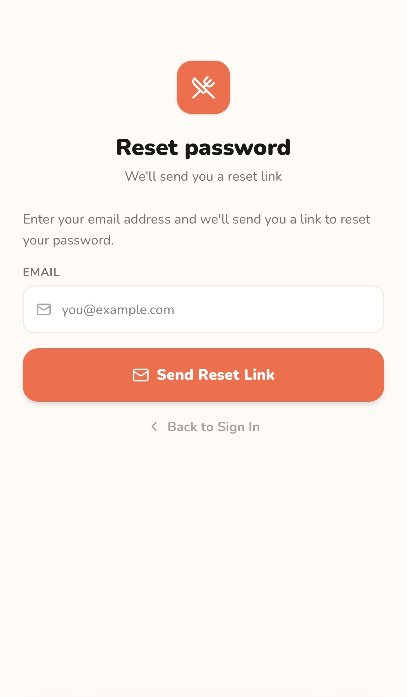

- Forgot your password? Tap **Forgot password?**, enter your email, and tap
  **Send Reset Link**.

**Tip:** on your phone, use **Add to Home Screen** (or **Share → Add to Home
Screen** on iPhone) to open the app in one tap at the restaurant.

## 2. Tell us your taste (My Taste)

You do this once. You can change it any time from the **My Taste** tab.

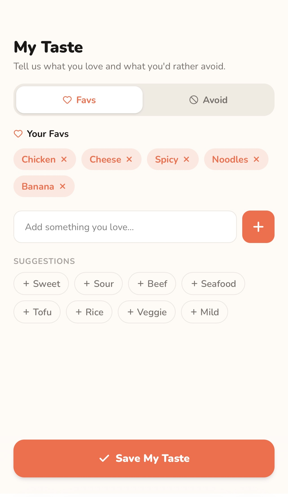

**Favs** — foods you love. Type one and tap **+**, or tap a suggestion. Tap
**×** to remove one.

**Spice level** — choose how hot you like it. Hotter dishes are marked
**Check First**, with a way to ask for it milder.

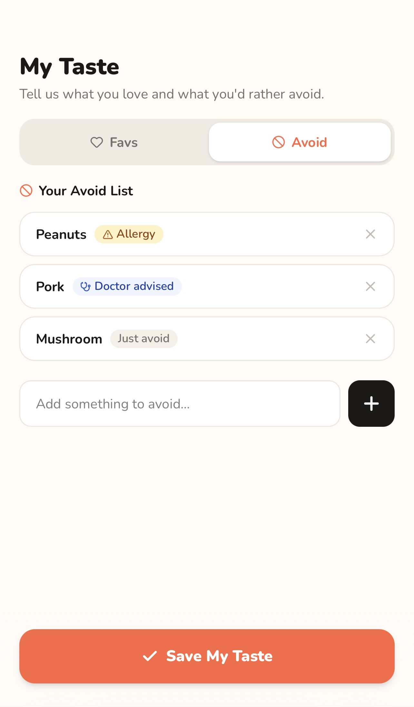
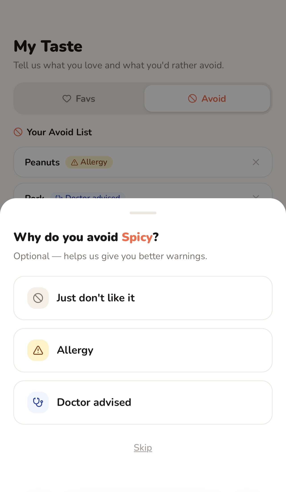

**Avoid** — foods you don't eat. When you add one, choose **why**:

| Reason | Badge | What it changes |
|---|---|---|
| Just don't like it | grey | the dish becomes **Check First** |
| Allergy | ⚠ amber | the dish becomes **Avoid** |
| Doctor advised | 🩺 blue | the dish becomes **Avoid** |

The first time you add an **Allergy** or **Doctor advised** item, the app asks
**"Allow us to store health information?"**. This is your choice. You can edit
or delete these items at any time.

## 3. Upload a menu

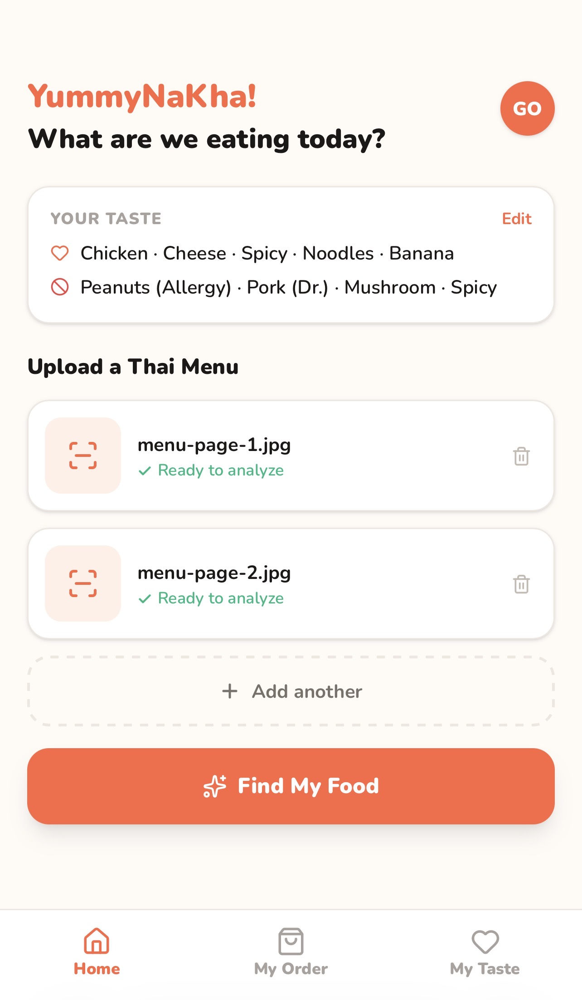

1. On **Home**, tap **Snap or choose a menu photo**.
2. One page per photo, taken straight on. Menu has more pages? Add more photos.
3. You can **crop and rotate** a photo before scanning.
4. Tap **Find My Food**.

Tips: flat menu, good light, whole page in the frame, no glare.

**First time only — "Before we read your menu":**

- Read and accept the **Terms of Use**, **Privacy Notice** and **AI & Accuracy
  Disclaimer**.
- On the online version, your menu **photo only** is sent to **OCR.space** to
  read the text. Your food profile and account details are **never** sent.
- **Menu helper (optional):** sends only the menu text to Google Gemini to pair
  dishes with meats that are listed separately. Leave it off if you prefer.

You can change these later in **Profile → Privacy & consents**.

## 4. Wait a few seconds

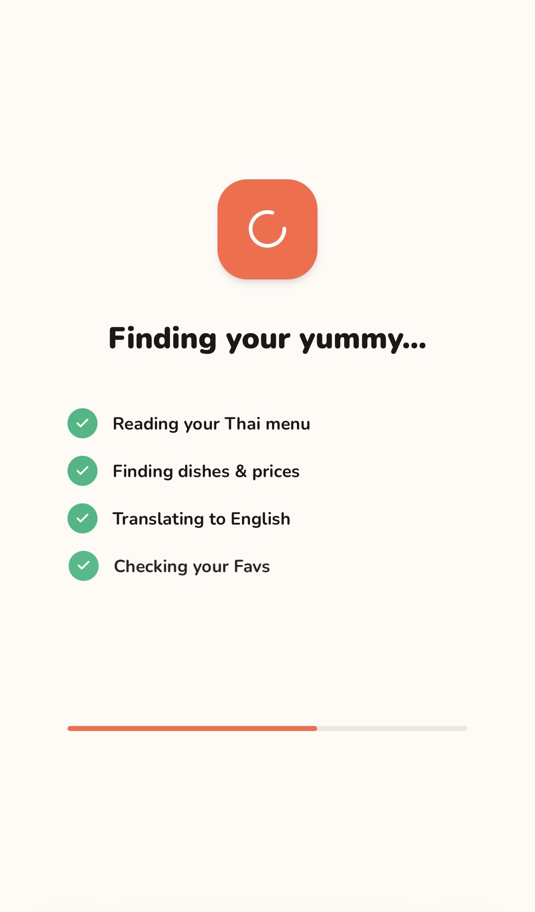

The app reads the menu, finds dishes and prices, looks each one up in our Thai
dish guide, and checks it against your Favs and Avoid list.

## 5. Read your menu

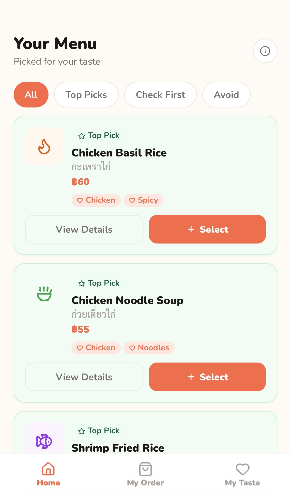
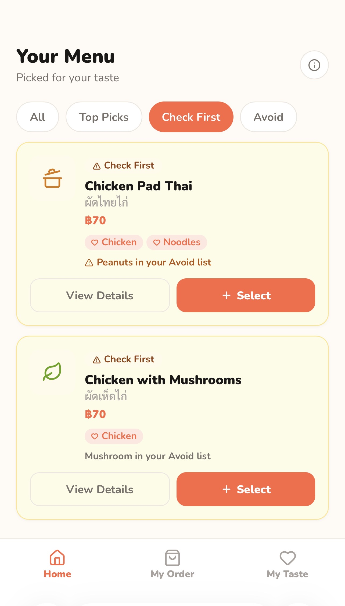
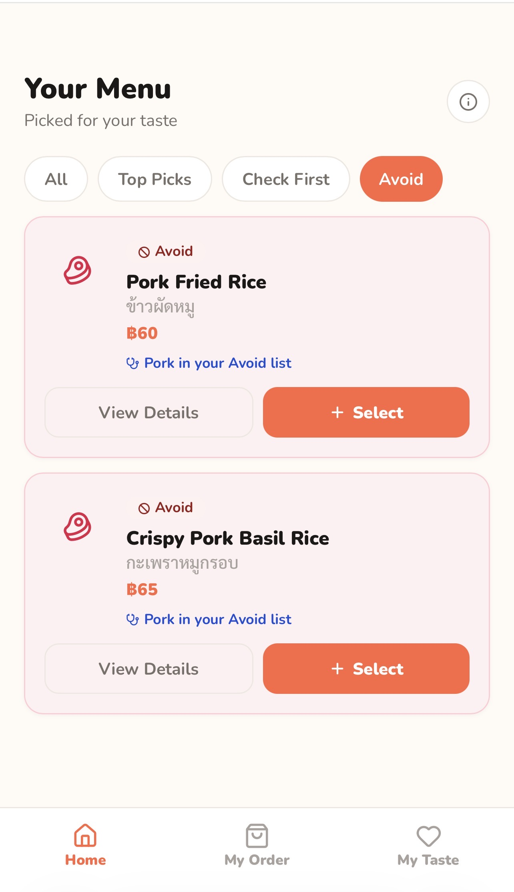

Every dish shows its English name, Thai name and price, in one of three groups:

| Group | Meaning | What to do |
|---|---|---|
| 🟢 **Top Picks** | Matches your Favs. No conflicting ingredient was detected from the menu information. | Still mention allergies to staff |
| 🟡 **Check First** | May contain something on your Avoid list, too spicy, or the app is not sure about the dish | **Ask restaurant staff before ordering** |
| 🔴 **Avoid** | Contains something on your Avoid list | **Ask restaurant staff**, or choose another dish |

- **Filter:** All · Top Picks · Check First · Avoid.
- **View:** *Best for me* (best matches first) or *Menu order* (same order as the
  printed menu).
- **Search** in English or Thai, e.g. "tom yum". **Sort** by best match,
  cheapest or priciest.
- A warning line tells you **why**, e.g. "⚠ Peanuts in your Avoid list".
- **"Rough translation — not in our dish guide"** or **"Not translated yet — ask
  staff"** means we don't know this dish well. It is always Check First.
- Tap **ⓘ** to read *About food warnings*.

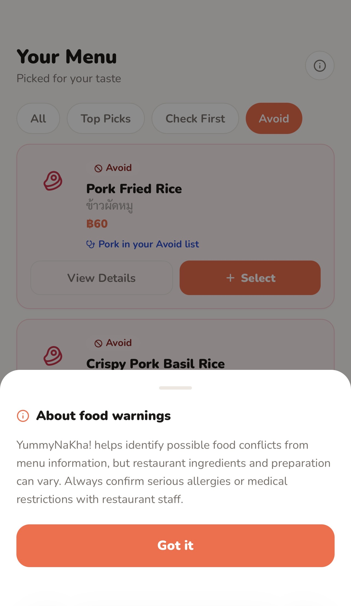

## 6. Look at a dish

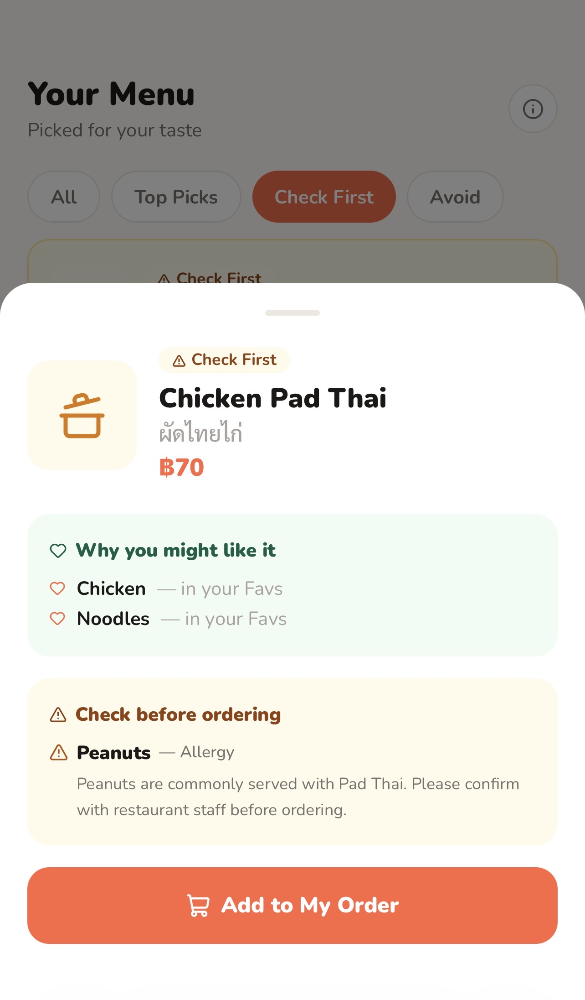
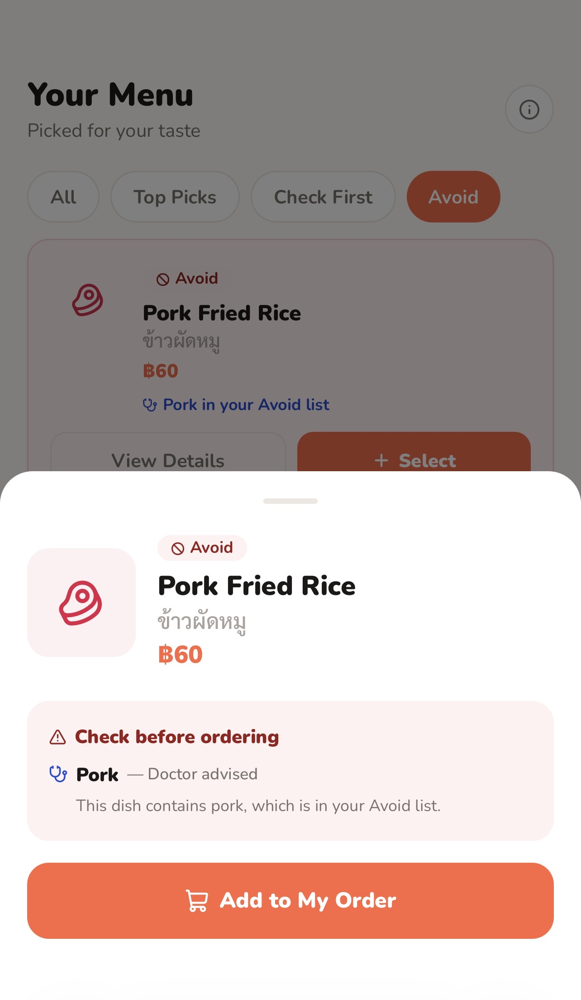

Tap a dish to see:

- **Why you might like it** — which of your Favs it matches.
- **Check before ordering** — which Avoid item it may contain, and why.
- **Main ingredients** and **Often added**, with Thai names, a short
  description and spice level. These come from the usual recipe — each
  restaurant cooks its own way.
- **Show on menu photo** — see where the dish is on your photo, to point at it.
- **Report a problem** — wrong name, ingredients or price. This helps us fix the
  dish guide.

Tap **Add to My Order**, or tap outside to close.

## 7. Build your order

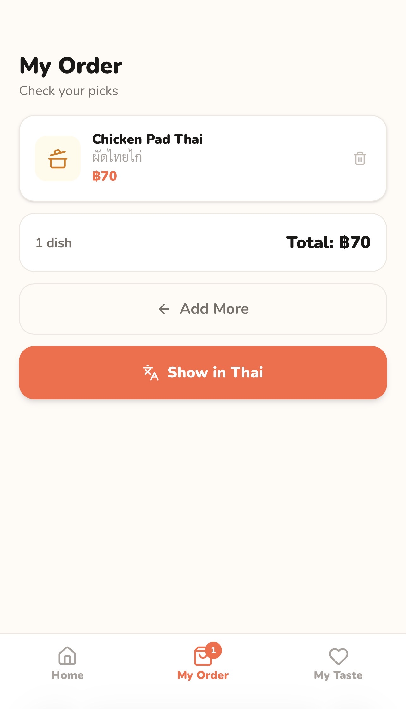

- Tap **+ Select** on a dish. The **My Order** tab shows how many you picked.
- In **My Order**, use **− / +** to change how many, 🗑 to remove.
- Tap **Add a request (e.g. not spicy)** to add a Thai request to a dish.

## 8. Order in Thai

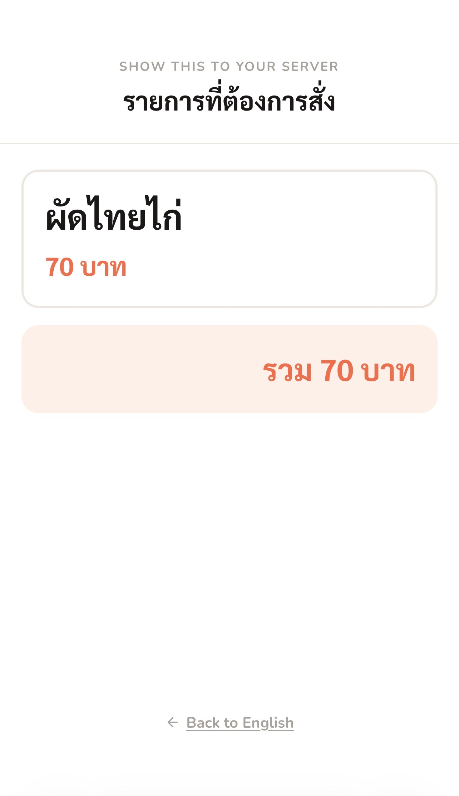

Tap **Show in Thai**:

- Your dishes appear **in large Thai text**, with quantity and price in บาท.
- 🔊 **Listen** reads a dish name aloud in Thai.
- **Ask the staff** — ready-made Thai sentences, e.g. about your allergy. Use
  them to check with staff.
- Open the **full-screen staff view** and hand the phone to your server.

## 9. Your profile

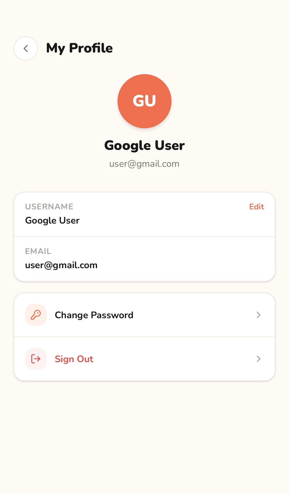
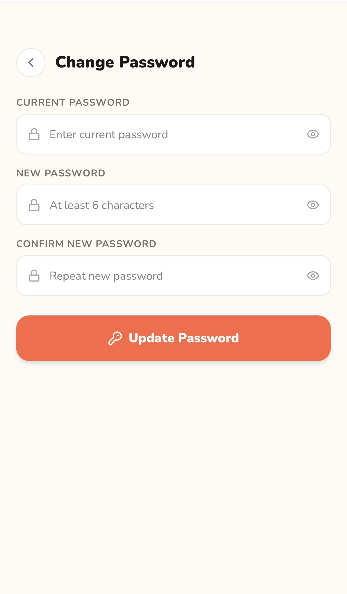

Tap your initials (top right of Home) to:

- edit your username,
- **Change Password** (not needed if you sign in with Google),
- choose a **colour theme** (result colours never change),
- open **Privacy & consents** to see or withdraw what you agreed to,
- **Sign Out**,
- **Delete account** — removes your account, Favs and Avoid list, menu photos,
  results and agreement history. You confirm with your password or email.

---

## Need help?

| Problem | Try this |
|---|---|
| "Nothing was read" / no dishes | Retake the photo: flat, good light, no glare, one page |
| A price is missing | Check the menu or ask staff — the app never guesses a price |
| Many **Check First** dishes | The menu doesn't say enough — ask staff about those dishes |
| A result looks wrong | Trust the restaurant staff, not the app, and tap **Report a problem** |
